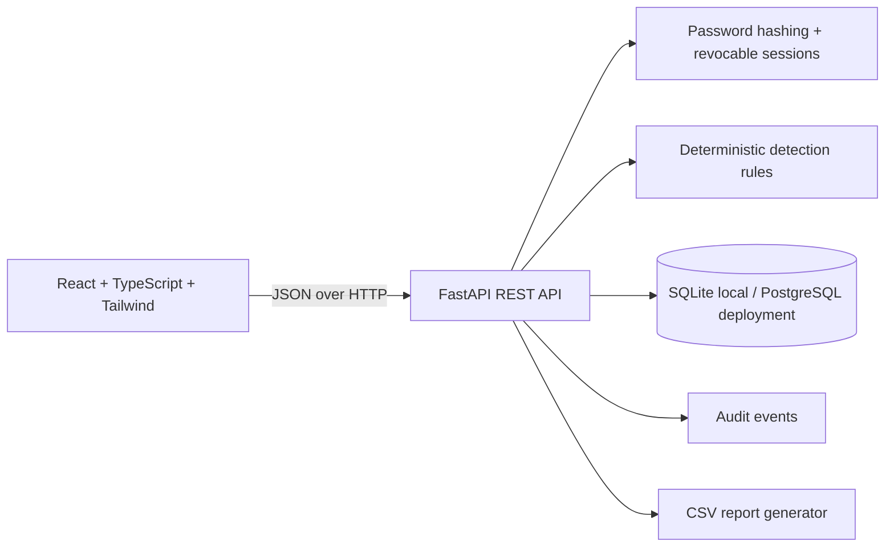

# Architecture

- Frontend is a Vite single-page app.
- Backend validates inputs with Pydantic and enforces role checks in dependencies.
- SQLAlchemy models support SQLite local demo and PostgreSQL deployment.
- Demo records are fictional and clearly identified as DEMO DATA.
